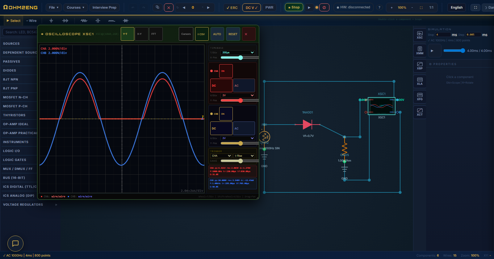
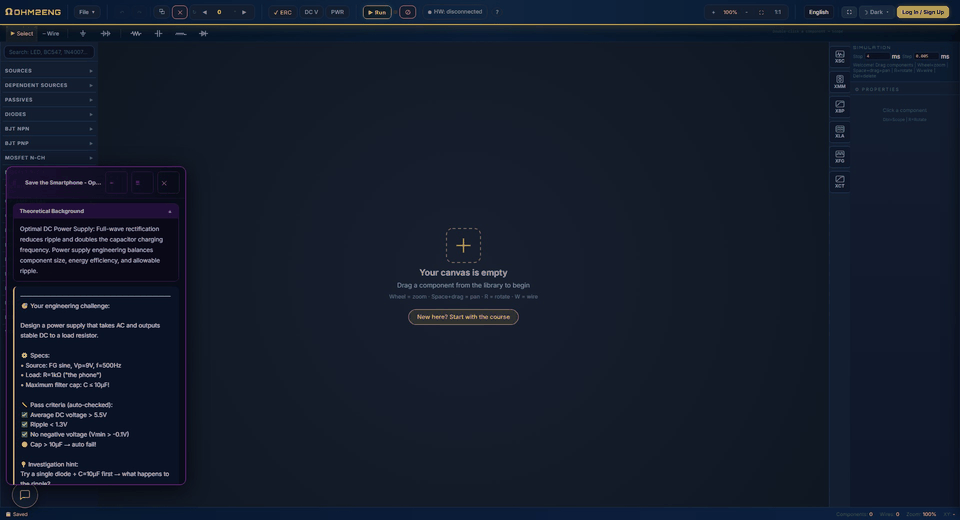
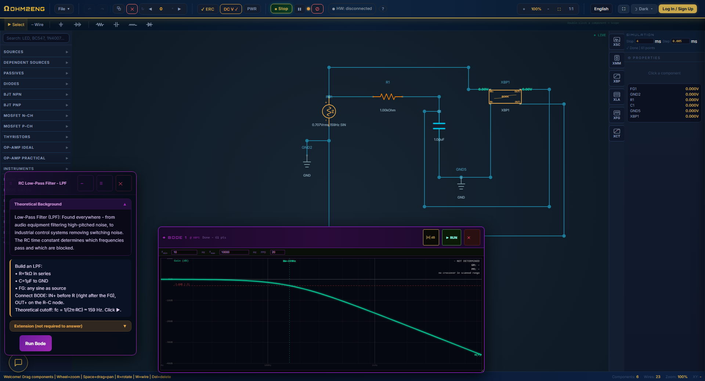
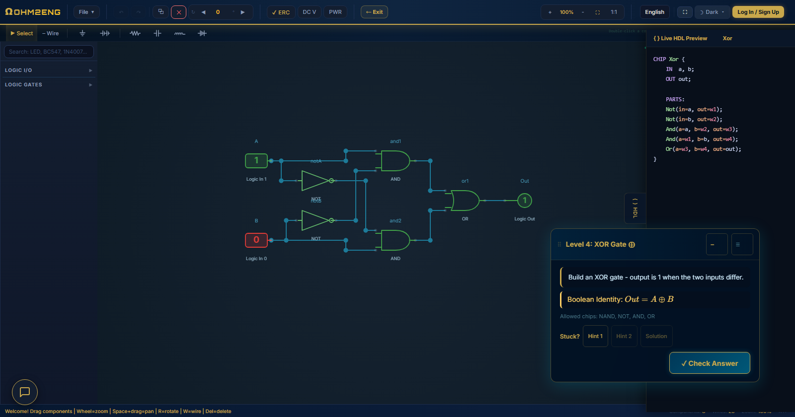
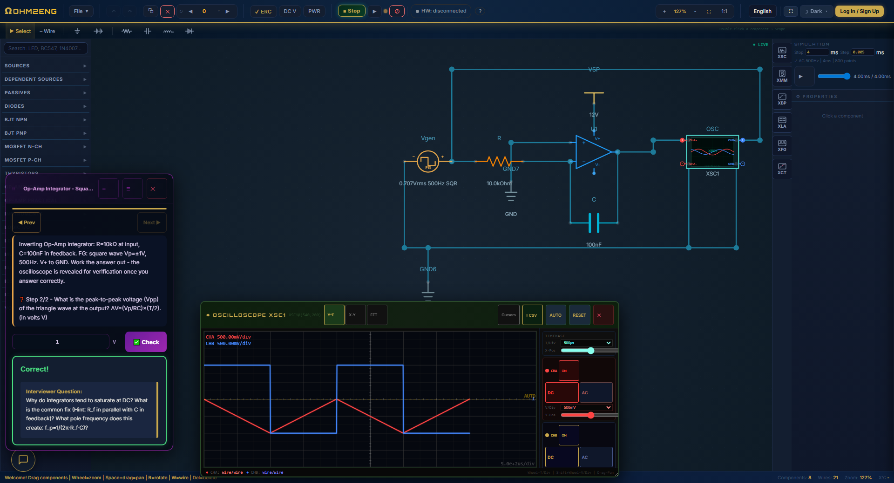
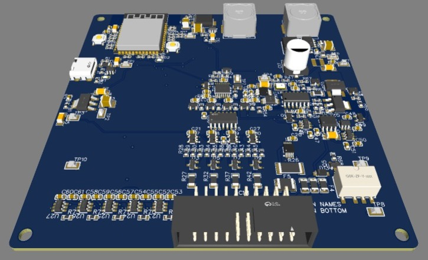
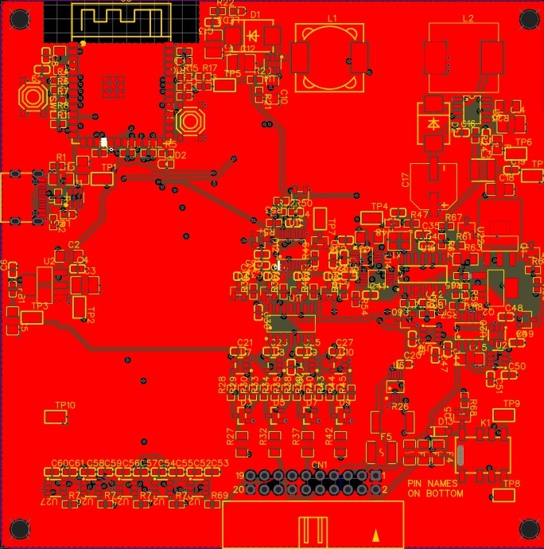

# OHM2ENG

> A browser-based electrical circuit simulator with a deep, interactive education layer.
> **Draw a circuit → press Run → get real results** - DC, AC / Bode, transient, sweeps, noise, pole-zero, Monte-Carlo and Fourier, from an engine held to ngspice - plus full engineering & computer-science courses built on real emulators, graded labs, and an optional USB card that answers the very same exercise from a real breadboard.

🌐 **Live:** [ohm2eng.com](https://ohm2eng.com)

*A public overview of OHM2ENG. The full project source is private - access is available on request (see [Status](#status)).*

*A half-wave rectifier running live - the oscilloscope shows the input sine (blue) against the rectified output (red), solved by the MNA engine and drawn back in the browser.*

### The whole loop, end to end

*One lab from start to finish. The task asks for a DC power supply; a transformer, a diode bridge, a smoothing capacitor and a load get wired up; **Run** solves the transient right in the browser, in a background worker - the circuit is small enough; channel B (blue) reads the AC input while channel A (red) reads the rectified, smoothed output; and **Check** grades the circuit against the lab's own pass criteria - average DC above 5.5 V, ripple under 1.3 V, no negative excursion - and explains why it passed. Nothing here is mocked: the 7.23 V average and 0.58 V ripple come out of the solver.*

---

## Purpose

**OHM2ENG exists to be the single place a student needs, instead of a dozen scattered tools.**

The philosophy is *learn by doing, then get verified*. Every exercise ends in a grade produced by running the student's own work - solving their circuit, or executing their code - never by matching it against a stored answer.

A teaching platform first, and a serious circuit simulator second.

---

## Who it is for

**Electrical-engineering and computer-science students** - from their first digital-circuits and computer-architecture courses, through the analog and digital lab courses, to the job interview at the end - and **the lecturers who teach them**, who can follow a class's progress from inside the app. The whole interface runs in **Hebrew and English**.

---

## What is this?

OHM2ENG does two big things in the browser, and a third that reaches outside it:

1. **Analog + digital circuit simulator.** Place components on an HTML5 canvas - 254 of them, from resistors, transistors and op-amps to sources, logic gates and ICs - wire them up, hit **Run**, and read results back through real virtual instruments: **oscilloscope, multimeter, Bode plotter, logic analyzer, function generator, curve tracer**.

   Underneath is a SPICE-class engine: DC operating point, AC / Bode, transient, parameter sweeps, noise, transfer function, pole-zero, Monte-Carlo tolerance runs and Fourier / THD. Devices are modelled the way SPICE models them - Gummel-Poon BJTs; MOSFETs with a smooth subthreshold-to-saturation channel, a body diode and datasheet capacitances; junction capacitance on diodes, BJTs and JFETs - and parts such as the TL431, optocouplers, photodiodes and power MOSFETs take their numbers straight from the manufacturer's datasheet. **The engine is held to ngspice**, the open-source reference simulator: dozens of tests compare it against golden ngspice output, and differential fuzzers throw random circuits at both simulators and compare the answers.

*A guided lab: build an RC low-pass filter, then run an AC sweep on the Bode plotter and watch the gain roll off past its ~159 Hz cutoff - the task panel gives you the theory and checks your circuit.*

2. **An electrical-engineering & CS learning platform.** A 16-lecture digital-circuits course; a comprehensive **computer-architecture course** whose *first part* is building a working computer from a single NAND logic gate up (through **Hack**, a **VM**, and a **Jack compiler**), and which then goes well beyond that foundation into **RISC-V, datapath & control, pipelining, caches, and virtual memory** - with genuine emulators at every layer.

   Chip levels are *drawn*; from project 4 on they are *written* - the student types real **Hack assembly** and later **RISC-V**, and the emulator runs the program to decide whether it passed.

   Alongside it: **graded labs** - 28 experiments with 150 sections in three labs, each section checked against the student's own work by solving their circuit, reading its waveforms or running its truth table - and **job-interview prep** (a career center of graded EE/CS questions). All of it is wrapped in a Leitner **spaced-repetition** scheduler and cloud progress sync. **Guests** get every course, instrument and interview; **registered** users also save circuits and sync progress across devices. **Lecturers** get a class view: students join their class with a code, and the lecturer follows their progress and study time.

*The computer-architecture course in action: build an XOR gate from NOT / AND / OR primitives, watch the live HDL preview write the `CHIP Xor` definition as you wire it, then have it graded against its full truth table - one step on the path from a single logic gate up to a working CPU.*

*Interview prep, graded. An op-amp integrator fed a square wave: the question asks for the time constant, then for the peak-to-peak swing of the output - and the oscilloscope stays **hidden** while you answer, so the numbers have to be derived rather than read off. Answer both correctly and the scope opens on the triangle wave you just predicted, followed by the interviewer's next question.*

---

## The core idea: one circuit, swappable result producers

The browser owns the circuit - it draws it, edits it, and turns it into a netlist. Where the *numbers* come from is a separate, swappable layer, and the exercise's grader never knows which one answered:

1. **In the browser - the default.** The solver, a **Modified Nodal Analysis (MNA)** engine with a sparse LU, **Newton-Raphson** iteration and full device models, is one module that also ships to the client. Any circuit of up to 30 nodes is solved right in the page - the transient in a background worker, so the UI stays responsive and *Stop* really stops. No network round-trip per Run.
2. **On the server - large circuits.** Above that, the very same engine runs in a Cloudflare Worker, where a heavy solve does not block the tab, under a bounded work budget.
3. **On a real breadboard - optional.** With the OHM2ENG card attached, real measurements fill the exact context the solver would have filled (see below).

Purely digital circuits skip the analog solver altogether and evaluate as boolean logic in the browser.

**→ For a deeper look at the design, read [ARCHITECTURE.md](ARCHITECTURE.md).**

---

## Optional: solve the same exercise on real hardware

Every exercise is fully solvable in simulation, and always will be. But a student who wants to can **build the circuit on a breadboard**, plug the **OHM2ENG card** (below) into the computer, and answer the *same* task with *real* measurements.

The point is that nothing about the exercise changes. The grader does not know which arena it is in: a real measurement is fed into the exact context the checker already consumes, so the same question, checked the same way, is now answered by a physical circuit. There is also a **compare** view that plots the simulated and measured waveforms on one shared axis and names the difference - gain, offset, or genuine shape - which is where the interesting learning actually happens.

Design rules worth stating: the bridge **informs, it never locks** (no exercise becomes unsolvable without a board); the instrument is treated as **untrusted input** and validated at one boundary; trusting a measurement requires a **three-step calibration** proved against a reference on the card itself, not against the student's own wiring; and the whole feature stays **hidden from students who have never connected a board**, so nobody meets it before it means anything to them.

### The card

  
  

*The OHM2ENG card as ordered - the assembled board and its top copper layer, rendered from the design files. A photo of the real one follows bring-up.*

One USB card in place of a lab bench. It **measures** the student's breadboard and **feeds** it:

- a **4-channel oscilloscope and voltmeter** - ±33 V, auto-ranging down to 4 mV steps
- a **function generator** - sine, triangle or square, up to 100 kHz
- a **programmable DC supply** - current-limited, so a short is harmless
- a **current meter**, plus **resistance** and **capacitance** readings
- **5 digital lines**, each an input or an output

All of it over the one cable that also powers the card - no bench supply, no driver to install. The student builds on a breadboard, runs jumper wires from a single labelled connector, flips the task from *Simulation* to *Hardware*, and the app works out from the drawn circuit which output drives what. The outputs stay disconnected until the card is ready, so nothing reaches the breadboard by accident.

> **Status:** designed and checked; the first boards are in fabrication (November 2026). The software side is complete and tested against a model of the card.

---

## Tech stack

| Layer | Technology |
|-------|-----------|
| **Client** | Vanilla ES6 modules + HTML5 Canvas (no framework) |
| **Server** | Cloudflare Worker - Hono framework, TypeScript |
| **Solver** | MNA with a sparse LU + Newton-Raphson, variable-step transient (~21,700 lines, isomorphic client/server), held to ngspice |
| **Hardware** | Web Serial → the OHM2ENG USB card, its own firmware |
| **Hosting** | Cloudflare Pages + Worker |
| **i18n** | Hebrew / English |

---

## Highlights

- **254 components** across **32 categories** in the parts library, many with numbers read from the manufacturer's datasheet
- **Nine analyses:** DC operating point, AC / Bode, transient, parameter sweeps, noise, transfer function, pole-zero, Monte-Carlo tolerance and Fourier / THD
- **Held to ngspice** - golden-output tests for SPICE export, noise, transfer function, pole-zero and Fourier, plus differential fuzzers that run random circuits through both simulators
- Real device physics: Gummel-Poon BJTs, MOSFETs (smooth subthreshold channel, body diode, datasheet capacitances), diodes and JFETs with junction capacitance, thyristors, op-amps (soft saturation + oscillator modes)
- Six draggable virtual instruments with FFT, Bode, and cursor measurements
- **EDA-style wiring** - orthogonal auto-routing around parts, a junction dot only where three or more connections meet, real T-joins, and a wire selected as one object: what looks connected is connected
- **Graded labs** - 28 experiments, 150 sections, each checked against the student's own circuit
- **Comprehensive computer-architecture course** - 126 levels in 13 projects; its first part builds a computer from a single NAND gate up (Hack / VM / Jack), then it extends well beyond into RISC-V, datapath & control, pipelining, caches, and virtual memory; student code is actually executed and graded, not pattern-matched
- **Job-interview prep** - a career center of graded EE/CS questions
- **Optional hardware bridge + the OHM2ENG card** - one USB card that is a scope, generator, DC supply and meter: build the circuit for real and answer the same graded exercise with real measurements; a compare view puts the simulated and measured waveforms on one axis
- **Class view for lecturers** - students join with a code; the lecturer follows progress and study time
- **10,000+ automated tests** - unit, Worker route, and browser end-to-end
- SPICE netlist import / export
- Electrical Rule Check (ERC)
- Spaced-repetition mastery tracking + two-way cloud progress sync

---

## Try it

It's **live and free to start** - open **[ohm2eng.com](https://ohm2eng.com)** in any browser, with nothing to install. Jump straight in as a guest, or create an account to save your progress across devices and follow the full course tracks. Works on desktop and tablet, in English or Hebrew.

---

## Status

> **This repository is only a condensed overview - a summary of what OHM2ENG is.**
> The **complete project**, documented in far greater detail, lives in a separate **private repository**: the full source code (client, Cloudflare Worker solver, all course content and emulators), the in-depth engineering handbook, the CI pipeline, and the full test suites - everything. Access to the full private repository can be granted on request - feel free to reach out (for example, via LinkedIn).

The application is live at **[ohm2eng.com](https://ohm2eng.com)** - no setup required. This is a proprietary project - see [LICENSE](LICENSE).

© OHM2ENG. Built with vanilla ES6, HTML5 Canvas, and Cloudflare Workers.
